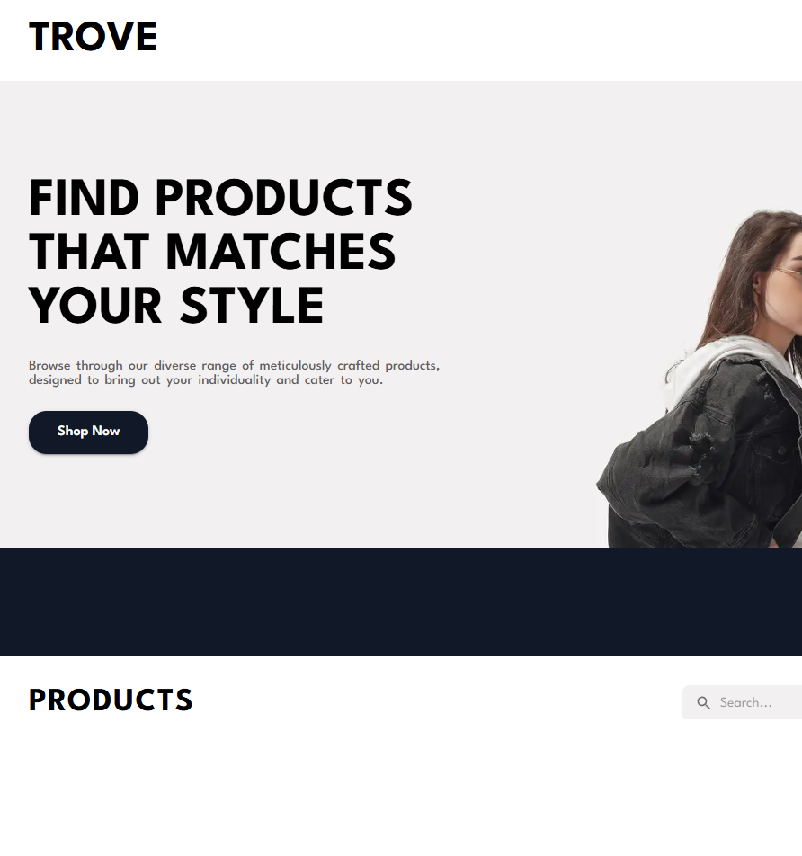
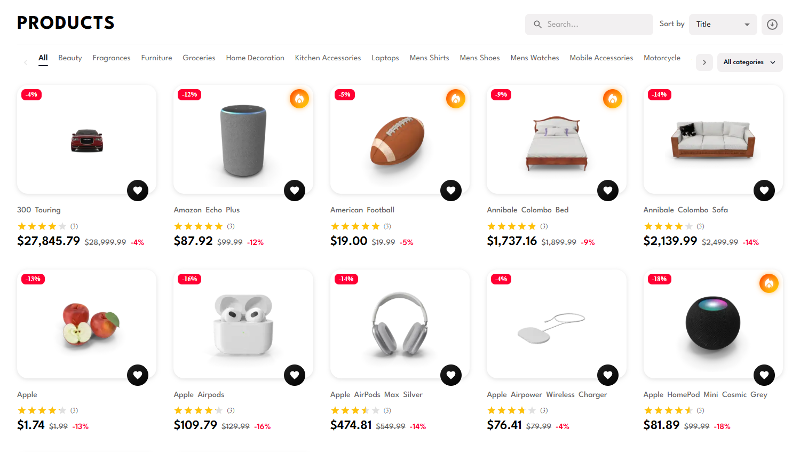
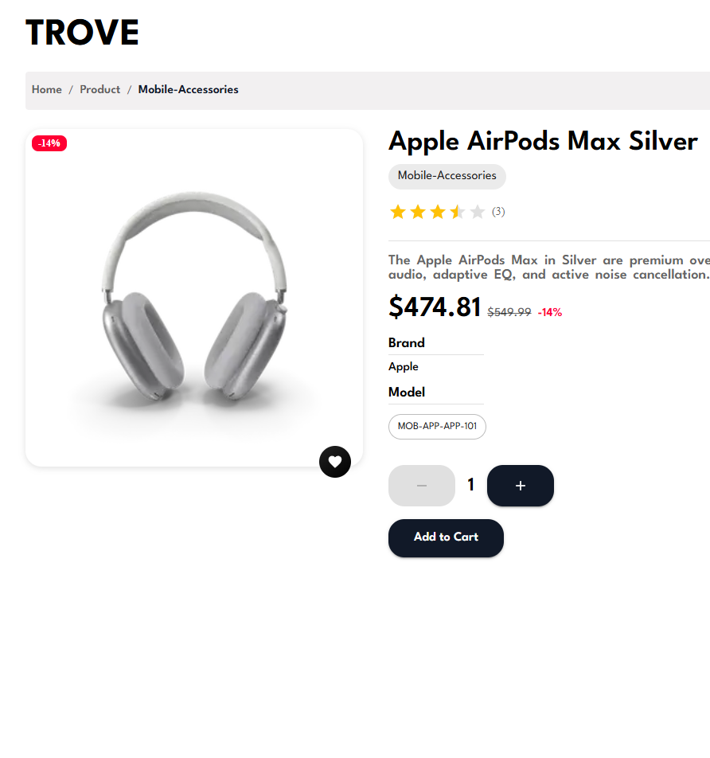
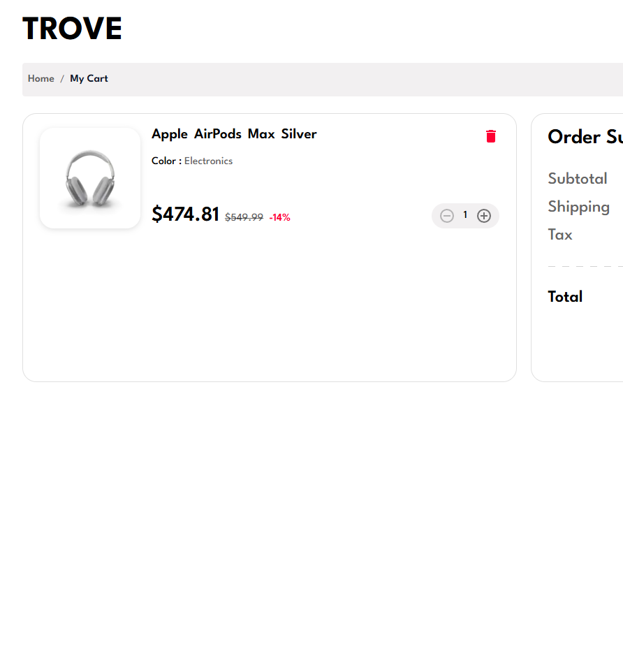
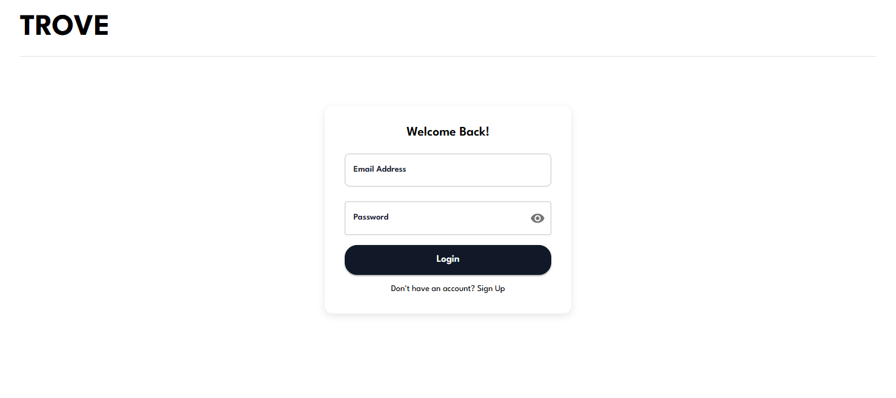

# Trove

[](https://github.com/MoShahan/trove/actions/workflows/ci.yml)
[](https://nextjs.org/)
[](https://react.dev/)
[](https://mui.com/)
[](https://firebase.google.com/)

**Trove** is an e-commerce storefront for browsing products, saving a wishlist, managing a cart, and checking out. Built with **Next.js App Router**, **Material UI**, and **Firebase Authentication**. Catalog data comes from [DummyJSON](https://dummyjson.com/).

**Live app:** [https://trove-shop.vercel.app](https://trove-shop.vercel.app/)

---

## Screenshots

**Home**



**Catalog** — search, categories, sale prices, and star ratings



**Product details**



**Cart**



**Login**



---

## Authentication (Firebase)

This project uses **real Firebase Authentication**, not a mock or demo login.

- **Provider:** Firebase Email/Password
- **Client:** `firebase/auth` via `src/lib/firebase/firebase.ts`
- **Config:** Firebase project settings live in `src/lib/firebase/config.ts` (keep these values as they are for login to work)
- **Session:** after a successful Firebase sign-in, the ID token is stored in an HTTP-only `user_session` cookie
- **Route protection:** `middleware.ts` verifies that token with the Firebase Identity Toolkit before allowing access to the store
- **Sign up:** `/sign-up` creates a real Firebase user with `createUserWithEmailAndPassword`
- **Login:** `/login` signs in with `signInWithEmailAndPassword`
- **Logout:** Navbar signs out of Firebase and clears the session cookie

Create an account on `/sign-up`, then use those same credentials on `/login`.

---

## Features

- **Firebase Auth** for signup, login, logout, and protected routes
- **Product catalog** with category filters, search, and title/price sorting
- **Product details** with quantity selection, wishlist toggle, and add-to-cart
- **Cart** with quantity updates, order summary, and checkout form
- **Wishlist** persisted in `localStorage`
- **Admin table** for client-side add/edit/remove/sort of products
- **Toast notifications** for cart, auth, and checkout actions
- **Responsive MUI layout** for mobile and desktop

---

## Tech stack

| Layer     | Tools                                              |
| --------- | -------------------------------------------------- |
| Framework | Next.js 15, React 19, TypeScript                   |
| UI        | Material UI 6, Emotion                             |
| Auth      | Firebase Authentication (Email/Password)           |
| Session   | HTTP-only cookie + Firebase ID token verification  |
| Data      | DummyJSON via Axios                                |
| State     | React state + `localStorage` for cart and wishlist |
| Tests     | Jest, React Testing Library                        |
| Quality   | ESLint (import order/groups), Prettier, Husky      |

---

## Project structure

```text
src/
  actions/          Server actions for Firebase session cookies
  app/              App Router pages (home, product, cart, wishlist, auth, admin)
  components/       UI for catalog, cart, auth, layout
  lib/firebase/     Firebase app config and Auth client
  utils/            HTTP client, token verification, theme, types
middleware.ts       Firebase token checks for protected routes
```

### Routes

| Route           | Description                    |
| --------------- | ------------------------------ |
| `/login`        | Firebase Email/Password login  |
| `/sign-up`      | Create a Firebase Auth account |
| `/`             | Banner + product grid          |
| `/product/[id]` | Product details                |
| `/cart`         | Cart, totals, checkout dialog  |
| `/wishlist`     | Saved products                 |
| `/admin`        | Product admin table            |

---

## Getting started

### 1. Clone and install

```bash
git clone https://github.com/MoShahan/trove.git
cd trove
npm install
```

### 2. Firebase

Firebase is already integrated. Auth uses the Firebase project configured in `src/lib/firebase/config.ts`, with Email/Password enabled. Replacing those values without a matching Firebase project would break sign-in.

To use your own Firebase project instead:

1. Create a project at the [Firebase Console](https://console.firebase.google.com/).
2. Enable **Email/Password** under Authentication.
3. Replace the values in `src/lib/firebase/config.ts` (and the API key used in `src/utils/firebase.ts`).

You can also load config from `.env.local` if you prefer not to keep keys in source:

```env
NEXT_PUBLIC_FIREBASE_API_KEY=your-api-key
NEXT_PUBLIC_FIREBASE_AUTH_DOMAIN=your-auth-domain
NEXT_PUBLIC_FIREBASE_PROJECT_ID=your-project-id
NEXT_PUBLIC_FIREBASE_STORAGE_BUCKET=your-storage-bucket
NEXT_PUBLIC_FIREBASE_MESSAGING_SENDER_ID=your-sender-id
NEXT_PUBLIC_FIREBASE_APP_ID=your-app-id
```

### 3. Run the app

```bash
npm run dev
```

Open [http://localhost:3000](http://localhost:3000), create an account on `/sign-up`, then sign in on `/login`.

---

## Scripts

| Script                  | Purpose                                      |
| ----------------------- | -------------------------------------------- |
| `npm run dev`           | Start the Next.js dev server                 |
| `npm run build`         | Production build                             |
| `npm start`             | Serve the production build                   |
| `npm run lint`          | ESLint via `next lint`                       |
| `npm run lint:fix`      | Auto-fix lint issues, including import order |
| `npm run format`        | Format files with Prettier                   |
| `npm run format:check`  | Check Prettier formatting in CI              |
| `npm test`              | Run Jest tests once                          |
| `npm run test:watch`    | Jest watch mode                              |
| `npm run test:coverage` | Jest with coverage                           |

---

## Testing and quality gates

- **Unit / component tests** live next to pages and under `src/components/__tests__`
- **CI** (`.github/workflows/ci.yml`) runs lint, Prettier check, and tests on every push and pull request
- **Pre-commit** uses Husky + lint-staged to run ESLint and Prettier on staged files

```bash
npm test
npm run lint
npm run format:check
```

### Import order

ESLint `import/order` groups imports as:

1. Built-ins
2. External packages (`react` first, then other libraries, then `@mui/*`)
3. Internal aliases (`@/`)
4. Parent / sibling / index
5. Type imports

---

## App data

- **Auth** is Firebase Email/Password with verified ID tokens
- **Catalog** is fetched from DummyJSON (`https://dummyjson.com`)
- **Cart** is stored in `localStorage` under `trove-cart`
- **Wishlist** is stored in `localStorage` under `trove-wishlist`
- **Checkout** collects shipping details and then clears the cart (no payment gateway)
- **Admin** edits happen in the browser and are not persisted to the API

---

## License

Private.
